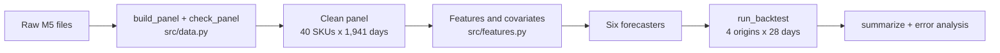

# Methodology: how the six forecasters are built and compared

Compiled October 25, 2026. Code is cited as `file:line`; papers are linked by DOI or arXiv id. Diagrams use Mermaid, which renders on GitHub.

---

## 1. The short answer

The study asks whether one global model trained on all SKUs forecasts daily demand better than a separate local model per SKU, and whether either beats simple baselines. To make that comparison fair, every forecaster plugs into one function signature and one rolling backtest, so all six see the same 40 SKUs, the same four forecast origins and the same 28-day horizon, and are scored on the same 4,480 SKU-days. Source: `src/backtest.py:43`, row counts in `outputs/predictions.csv`.

Three design choices carry the methodology. First, leakage is tested, not just avoided: one test perturbs future sales and checks that features do not move, and a second destroys the future and checks that no model's forecast changes. Second, the deep model predicts quantiles directly with pinball loss, so its uncertainty is learned rather than assumed Gaussian. Third, results are broken down by origin, horizon, demand class and SKU, because a single pooled score hides where each model fails.

The code's docstrings refer to "PRD FR-n". These are the functional requirements in the faculty-provided problem statement, which is not part of this repository.

---

## 2. Problem formulation

Let y(i,t) be units sold of SKU i on day t, with N = 40 SKUs, and let c(t) be calendar covariates. At an origin τ a forecaster sees all sales up to τ and the full calendar, which is published in advance. For every SKU and every horizon h from 1 to H = 28 it returns a point forecast and, where it can, the 0.1 and 0.9 quantiles.

In code, every model is a function `model(wide, cal, end, horizon)` returning a dict with `"point"` and optionally `"p10"` and `"p90"`, each an array of shape horizon by SKUs. `wide` is the full dates-by-SKUs sales table and `end` is the origin's row index; a model may read only `wide.iloc[:end]`. Source: docstring at `src/baselines.py:1`.



The backtest in the middle is the only place models meet the data, which is what makes the comparison like-for-like.

---

## 3. Features, and why they cannot leak

| Feature | Definition | Why it is there |
|---|---|---|
| `lag_1`, `lag_7`, `lag_14`, `lag_28` | Sales k days earlier | Autocorrelation peaks at 7, 14, 21, 28 |
| `roll_mean_7`, `roll_mean_28` | Mean of the previous w days | Recent level |
| `dayofweek`, `is_weekend` | Calendar | Weekend sales are 53% above Monday to Thursday |
| `month` | Calendar | Mild annual pattern |
| `is_event`, `snap` | Calendar | Known in advance; SNAP lifts sales about 10% |
| `item_code` | Integer id, declared categorical | Lets one pooled model learn SKU levels |

Source: `src/features.py:10` to `:15`; motivating figures from report section IV.

A feature is leakage-safe if its value on day t depends only on sales up to day t−1 plus the calendar. Lags get this from `shift(k)`. Rolling means call `shift(1)` before `rolling(w)`, so the window for day t covers days t−w to t−1 (`src/features.py:38`). Calling `rolling` first and shifting later would quietly include day t.

Notebook 02 tests the property twice. The feature test adds 1,000 to every sale from day 1,500 onward, rebuilds the feature table, and checks that every feature up to day 1,500 is unchanged while features for day 1,501 do change, which proves the test can detect leakage. The end-to-end test, at the last origin, replaces every post-origin sale with 999, reruns all six models, and checks that the point forecasts are identical to within 1e-4. Both pass in the committed notebook. This follows the leakage framework of [Kaufman et al., 2012](https://doi.org/10.1145/2382577.2382579).

---

## 4. The forecasters

### 4.1 Seasonal naive (lag 7 and lag 28)

`seasonal_naive` (`src/baselines.py:15`) repeats the last m observed days: with m = 7 it predicts "same weekday last week", and with m = 28 the same weekday four weeks back. It costs nothing and sets the bar: a model that cannot beat lag-7 naive adds no value ([Hyndman and Athanasopoulos, FPP3](https://otexts.com/fpp3/)).

### 4.2 Pooled gradient boosting

`gradient_boosting` (`src/baselines.py:28`) trains one scikit-learn `HistGradientBoostingRegressor` on all SKU-days before the origin: 200 trees, learning rate 0.1, maximum depth 6, squared-error loss, `item_code` as a native categorical. At the first origin that is about 72,000 rows ((1,829 − 28) days by 40 SKUs, after dropping rows whose 28-day lags are undefined). Gradient boosting builds an additive ensemble of trees, each fitted to the negative gradient of the loss ([Friedman, 2001](https://doi.org/10.1214/aos/1013203451)); under squared error that gradient is the residual.

Lags beyond day τ+1 are unknown at forecast time, so the 28 days are produced recursively (`src/baselines.py:47`): predict day τ+1, clip it at zero, write it into the history, rebuild features for τ+2, and repeat. This keeps the model leakage-free but lets errors compound. [Ben Taieb et al., 2012](https://doi.org/10.1016/j.eswa.2012.01.039) compare this recursive strategy with direct strategies.

Squared-error loss means the model estimates a conditional mean. Section 7 explains why that matters when comparing it with a median forecaster.

### 4.3 Local Kalman filter, one per SKU

The local linear trend (LLT) model keeps a hidden state x = [level, slope] for each SKU:

```
x(t) = F x(t-1) + w(t),   F = [[1, 1], [0, 1]],   w ~ N(0, Q)
y(t) = H x(t)   + v(t),   H = [1, 0],             v ~ N(0, R)
```

`KalmanFilter.update` (`src/kalman.py:23`) alternates a prediction step (x̂ = F x, P = F P Fᵀ + Q) with a correction step using the Kalman gain K = P Hᵀ / (H P Hᵀ + R). The ratio Q/R controls how fast the filter reacts: large means it chases each observation, small means it smooths. The filter is the minimum mean-squared-error estimator when the system is linear and the noise Gaussian ([Kalman, 1960](https://doi.org/10.1115/1.3662552)).

The weekly variant (`src/kalman.py:66`) appends six seasonal states, with the new seasonal value equal to minus the sum of the previous six plus noise, so the seven weekday effects sum to roughly zero. That gives an 8-dimensional state and H = (1, 0, 1, 0, 0, 0, 0, 0), which lets the filter learn a day-of-week profile the LLT model cannot represent. The variant is the team's extension; the specification asked for LLT only, and both are reported.

Noise is set by a fixed rule instead of maximum likelihood (`src/kalman.py:50`). R is the variance of the last 365 training days around their weekday means, with a floor of 0.1. Q is diag(0.05R, 0.0005R) for LLT, plus 0.001R on the leading seasonal state for the weekly model. The initial level is the mean of the first seven days, slope and seasonals start at zero, and P0 = 100·I is deliberately vague.

To forecast h steps ahead, `forecast` (`src/kalman.py:38`) applies the prediction step h times without updates. The predictive variance V(h) = H P Hᵀ + R grows with h, and the 80% interval is mean ± 1.2816·√V(h), clipped at zero. That assumes Gaussian errors on count data, which is the main reason the intervals are too wide (see `docs/RESULTS.md`).

### 4.4 Global quantile LSTM

One network is trained on all 40 SKUs at each origin (`src/global_model.py:86`).

**Inputs and scaling.** For each SKU and forecast start t, the network sees the previous 56 days. Sales are divided by κ = 1 + mean of those 56 days, so big and small SKUs look alike, in the spirit of DeepAR's scaling ([Salinas et al., 2020](https://doi.org/10.1016/j.ijforecast.2019.07.001)). Each input step has 6 values: scaled sales plus five calendar covariates (sine and cosine of day of week, weekend, event and SNAP flags; `src/global_model.py:19`). The +1 keeps κ positive for SKUs with an all-zero window.

**Architecture.** An LSTM with hidden size 32 ([Hochreiter and Schmidhuber, 1997](https://doi.org/10.1162/neco.1997.9.8.1735)) encodes the 56-day window. Its final hidden state is concatenated with a 4-dimensional learned item embedding and the flattened covariates of the 28 forecast days, giving a 176-dimensional vector (32 + 4 + 28·5). A two-layer perceptron (176 → 64 → 84, ReLU) maps it to a 28 by 3 matrix of scaled quantiles (`src/global_model.py:27`). The model has 22,068 trainable parameters: 5,120 in the LSTM, 160 in the embedding, 11,328 and 5,460 in the two linear layers.

**Direct multi-horizon output.** All 28 days come out at once, so no prediction is fed back as input and there is no error accumulation from recursion. This follows MQ-RNN ([Wen et al., 2017](https://arxiv.org/abs/1711.11053)) rather than DeepAR's autoregressive sampling.

**Loss.** Training minimises pinball loss averaged over the three quantiles and 28 horizons (`src/global_model.py:79`): ρ_α(u) = max(α·u, (α−1)·u) with u = y − q. The value q that minimises the expected pinball loss is the α-quantile of y ([Koenker and Bassett, 1978](https://doi.org/10.2307/1913643)), and pinball loss is a proper scoring rule ([Gneiting and Raftery, 2007](https://doi.org/10.1198/016214506000001437)). At α = 0.9, under-forecasting costs 9 times more than over-forecasting.

**Training.** At each origin the network starts from scratch. Training windows are those whose starts lie between day 56 and τ − 56, which is 1,718 starts by 40 SKUs = 68,720 windows at the first origin; their targets end at least 29 days before the origin. The 28 most recent window starts are the validation set (`src/global_model.py:96`). Adam ([Kingma and Ba, 2015](https://arxiv.org/abs/1412.6980)) with learning rate 1e-3, batch size 256, at most 20 epochs, early stopping with patience 3, and the best weights are restored. The only regulariser is early stopping: there is no dropout and no weight decay.

**Post-processing.** Outputs are multiplied back by κ. Quantiles are equivariant under positive scaling, so a quantile of y/κ times κ is a quantile of y. The three outputs are then sorted so that P10 ≤ P50 ≤ P90, which is the monotone rearrangement of [Chernozhukov, Fernández-Val and Galichon, 2010](https://doi.org/10.3982/ECTA7880), and clipped at zero. P50 is the point forecast.

### 4.5 Cold-start fallback

A SKU with fewer than 56 days since its first sale at the origin gets, for each forecast day, the median daily sales of the established SKUs on the same weekday over the last 28 days, and its intervals are left empty (`src/backtest.py:31` and `:57`). None of the 40 SKUs triggers the rule, so notebook 02 section 6 tests it by erasing all but the last ten days of one SKU and checking that every model returns the fallback for that SKU and nothing else changes.

---

## 5. Evaluation protocol

Four origins, 28 days apart, cover the last 112 days of data (`get_origins`, `src/backtest.py:16`). At each origin every model is refitted on data before the origin and forecasts the next 28 days for all 40 SKUs.

| Origin | Train until | Training days | Forecast window |
|---|---|---|---|
| 1 | 2016-01-31 | 1,829 | 2016-02-01 to 2016-02-28 |
| 2 | 2016-02-28 | 1,857 | 2016-02-29 to 2016-03-27 |
| 3 | 2016-03-27 | 1,885 | 2016-03-28 to 2016-04-24 |
| 4 | 2016-04-24 | 1,913 | 2016-04-25 to 2016-05-22 |

Source: origins in `outputs/predictions.csv`; report Table V.

Rolling origins are preferred to one train/test split because they show whether a ranking holds across different periods ([Tashman, 2000](https://doi.org/10.1016/S0169-2070(00)00065-0)). A fairness assertion in notebook 02 section 5.1 confirms that all six models are scored on exactly the same origin, date, SKU and actual rows.

| Metric | Formula | Notes |
|---|---|---|
| MAE | mean of abs(y − ŷ) | Minimised by the median |
| RMSE | sqrt of mean of (y − ŷ)² | Minimised by the mean; punishes large misses |
| WAPE | sum abs(y − ŷ) / sum y | Volume-weighted; defined when single actuals are zero, `NaN` if all are |
| Pinball loss | mean of ρ_α(y − q̂) at α = 0.1, 0.5, 0.9 | Scores each quantile |
| Coverage | share of y inside [P10, P90] | Target 0.80 |
| Mean interval width | mean of P90 − P10 | Wide intervals can buy coverage |

Source: `src/metrics.py`; width computed in notebook 02 and in `docs/RESULTS.md`.

WAPE replaces MAPE because MAPE divides by each actual and breaks on zeros ([Hyndman and Koehler, 2006](https://doi.org/10.1016/j.ijforecast.2006.03.001)). A useful reference point: forecasting zero everywhere scores a WAPE of exactly 1.0, so any model above 1.0 on a group of SKUs is doing worse than predicting nothing.

---

## 6. Design decisions and the alternatives we did not take

**DeepAR instead of the quantile LSTM.** DeepAR with a negative-binomial likelihood fits count data better than a direct quantile head and is the natural next step. It was not used because the GluonTS tooling carried integration risk, and the specification allowed a quantile LSTM as a fallback. The LSTM keeps DeepAR's main ideas, one global network, item embedding, known future covariates and scale normalisation, while staying small enough to explain line by line.

**Maximum-likelihood noise for the Kalman filter.** Fitting Q and R by likelihood ([Durbin and Koopman, 2012](https://doi.org/10.1093/acprof:oso/9780199641178.001.0001)) would probably narrow the intervals. The fixed rule was chosen to keep the local model simple and transparent, and its cost shows up in the results as 95% coverage on an 80% interval.

**Croston-type baselines.** Croston's method ([Croston, 1972](https://doi.org/10.1057/jors.1972.50)) and its SBA correction ([Syntetos and Boylan, 2005](https://doi.org/10.1016/j.ijforecast.2004.10.001)) are built for intermittent demand, and 22 of the 40 SKUs are intermittent. Their absence is a gap, not a reasoned rejection.

**A tuned or count-aware gradient boosting model.** Poisson or Tweedie objectives, LightGBM and hyperparameter search were common among the top M5 entries. One fixed configuration with squared-error loss was used here, so the LSTM's lead over gradient boosting is best read as an upper bound.

**Transformers.** The Temporal Fusion Transformer ([Lim et al., 2021](https://doi.org/10.1016/j.ijforecast.2021.03.012)) extends the direct multi-horizon design with attention, but it is unlikely to pay for its complexity on 40 series.

---

## 7. Known threats to validity

The LSTM's point forecast is a median and the other models forecast means. The median minimises absolute error ([Kolassa, 2020](https://doi.org/10.1016/j.ijforecast.2019.02.017)), so MAE and WAPE favour it on zero-heavy counts. The LSTM also wins on RMSE, which favours means, but by a smaller margin (3.533 against 3.672), so part of its MAE advantage reflects the choice of statistic rather than skill. Source: `outputs/metrics.csv`.

The LSTM's validation windows are the 28 most recent window starts before the origin, and their targets overlap the latest training targets by up to 27 days, so the validation loss used for early stopping is optimistic. It affects only which epoch is kept and never exposes test data.

All models use one untuned configuration, there is no formal significance test such as [Diebold and Mariano, 1995](https://doi.org/10.1080/07350015.1995.10524599), and the results cover one store, one category and four consecutive windows from February to May 2016.

---

## 8. Further reading

1. Makridakis, Spiliotis and Assimakopoulos, M5 accuracy competition: results, findings, and conclusions, IJF 2022: [doi:10.1016/j.ijforecast.2021.11.013](https://doi.org/10.1016/j.ijforecast.2021.11.013)
2. Montero-Manso and Hyndman, Principles and algorithms for forecasting groups of time series: locality and globality, IJF 2021: [doi:10.1016/j.ijforecast.2021.03.004](https://doi.org/10.1016/j.ijforecast.2021.03.004)
3. Hyndman and Athanasopoulos, Forecasting: Principles and Practice, 3rd ed.: [otexts.com/fpp3](https://otexts.com/fpp3/)
4. Salinas et al., DeepAR, IJF 2020: [doi:10.1016/j.ijforecast.2019.07.001](https://doi.org/10.1016/j.ijforecast.2019.07.001)
5. Wen et al., A multi-horizon quantile recurrent forecaster (MQ-RNN), 2017: [arXiv:1711.11053](https://arxiv.org/abs/1711.11053)
6. Syntetos, Boylan and Croston, On the categorization of demand patterns, JORS 2005: [doi:10.1057/palgrave.jors.2601841](https://doi.org/10.1057/palgrave.jors.2601841)
7. Kolassa, Why the "best" point forecast depends on the error or accuracy measure, IJF 2020: [doi:10.1016/j.ijforecast.2019.02.017](https://doi.org/10.1016/j.ijforecast.2019.02.017)

The full reference list with all 29 works is in `AML-DL-Report.pdf`.

---

## 9. Caveats

Line numbers refer to commit `cb61b84` and will drift as the code changes. The parameter count and window counts were derived from the code and match the report; they were not printed by a fresh training run, because PyTorch was not installed where these docs were written. The leakage test checks point forecasts at the final origin only. Interval outputs come from the same code paths, but the test does not compare them directly.
