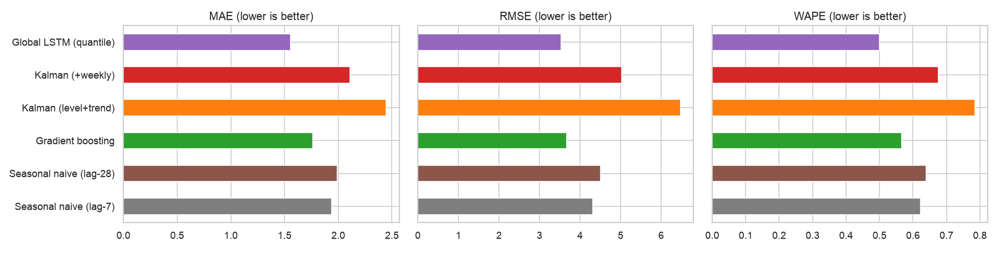
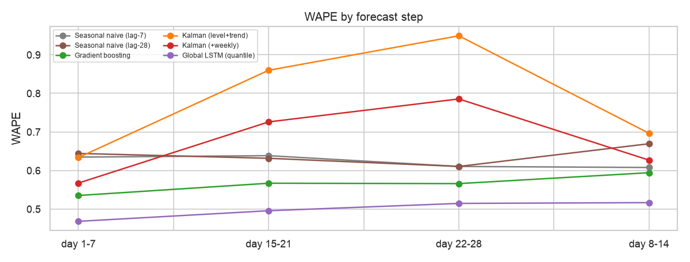
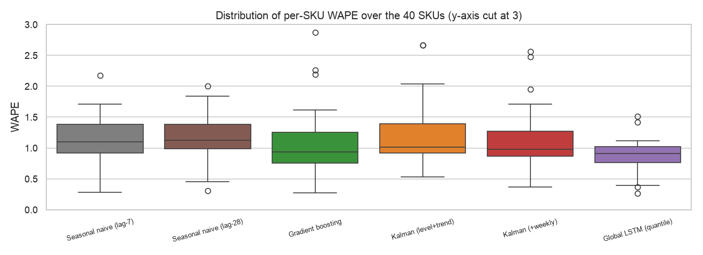
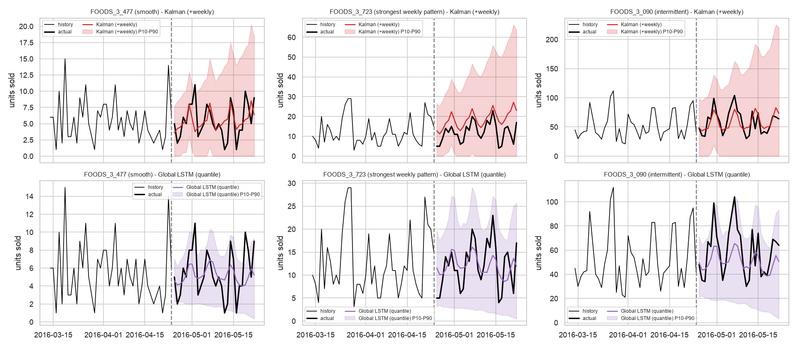

# Results: the global LSTM wins on every view, the Kalman filter on none

Compiled October 25, 2026. Every table below was recomputed from `outputs/predictions.csv` and matches `outputs/metrics.csv` and the IEEE report (`AML-DL-Report.pdf`, section VIII) to three decimals. Lower is better for every error metric; coverage should be close to 0.80.

---

## 1. The short answer

The global quantile LSTM is the most accurate forecaster in this study and the only one whose uncertainty is well calibrated. It has a pooled WAPE of 0.499, against 0.566 for gradient boosting and 0.623 for the lag-7 seasonal naive. It wins at all four origins, in all four demand classes and in every weekly horizon block, and its 80% interval covers 81.2% of outcomes. Source: `outputs/metrics.csv`, tables below.

First, the lead is robust. It holds across three random seeds (WAPE 0.501 ± 0.003) and after removing FOODS_3_090, the single SKU that supplies 42.9% of test volume. Without that SKU the ranking is unchanged: LSTM 0.677, gradient boosting 0.789. Source: notebook 02 section 7.5; exclusion recomputed from `outputs/predictions.csv`.

Second, the local Kalman filter never wins. Both variants lose to the lag-7 seasonal naive on pooled WAPE. Their intervals reach coverage only by being almost twice as wide as the LSTM's, 10.60 to 11.11 units against 5.98, which in inventory terms means excess safety stock.

Third, gradient boosting is the best classical model and the sensible fallback when deep learning infrastructure is not available: second on every pooled metric, trained in seconds, and easy to explain.

---

## 2. Overall accuracy

| Model | MAE | RMSE | WAPE | Pinball 0.1 | Pinball 0.5 | Pinball 0.9 | Coverage P10-P90 | Mean width |
|---|---|---|---|---|---|---|---|---|
| Global LSTM (quantile) | **1.555** | **3.533** | **0.499** | **0.290** | **0.778** | **0.489** | **0.812** | **5.98** |
| Gradient boosting | 1.763 | 3.672 | 0.566 | n/a | n/a | n/a | n/a | n/a |
| Seasonal naive (lag-7) | 1.940 | 4.310 | 0.623 | n/a | n/a | n/a | n/a | n/a |
| Seasonal naive (lag-28) | 1.992 | 4.511 | 0.639 | n/a | n/a | n/a | n/a | n/a |
| Kalman (+weekly) | 2.108 | 5.025 | 0.676 | 0.304 | 1.054 | 0.837 | 0.950 | 10.60 |
| Kalman (level+trend) | 2.445 | 6.475 | 0.785 | 0.307 | 1.223 | 0.890 | 0.945 | 11.11 |

Source: `outputs/metrics.csv`; mean width computed from `outputs/predictions.csv`. Pooled over 40 SKUs, 4 origins and 28 days, 4,480 SKU-days per model.

Source: `outputs/figures/11_model_comparison.png`, notebook 02 section 7.1.

Only two models beat the lag-7 baseline: the LSTM and gradient boosting. Adding weekly seasonality to the Kalman filter improves its WAPE from 0.785 to 0.676, which confirms that the weekly cycle found in the EDA is the dominant structure, but even the improved filter stays behind naive.

The pinball losses rank the models the same way at every quantile. The largest gaps are at P50 (0.778 against 1.054) and P90 (0.489 against 0.837). The LSTM's coverage of 0.812 sits 1.2 points from the 0.80 target. The Kalman filters' 0.945 and 0.950 look "safer", but an 80% interval that covers 95% is too wide, and the widths show the cost.

---

## 3. Stability across forecast origins

| Model | 2016-01-31 | 2016-02-28 | 2016-03-27 | 2016-04-24 |
|---|---|---|---|---|
| Global LSTM | **0.520** | **0.481** | **0.520** | **0.478** |
| Gradient boosting | 0.630 | 0.529 | 0.627 | 0.490 |
| Seasonal naive (lag-7) | 0.583 | 0.557 | 0.707 | 0.644 |
| Seasonal naive (lag-28) | 0.664 | 0.611 | 0.659 | 0.625 |
| Kalman (+weekly) | 0.619 | 0.578 | 0.946 | 0.581 |
| Kalman (level+trend) | 0.696 | 0.687 | 1.089 | 0.685 |

Source: WAPE recomputed from `outputs/predictions.csv`; column headers are the last training day.

The LSTM varies only between 0.478 and 0.520. Gradient boosting beats lag-7 naive at three of four origins and is narrowly worse at the first (0.630 against 0.583). Both Kalman filters spike at origin 3, which section 7 traces to a single SKU.

---

## 4. Error by forecast horizon

| Model | Days 1-7 | Days 8-14 | Days 15-21 | Days 22-28 |
|---|---|---|---|---|
| Global LSTM | **0.468** | **0.517** | **0.496** | **0.515** |
| Gradient boosting | 0.535 | 0.594 | 0.567 | 0.566 |
| Kalman (+weekly) | 0.567 | 0.627 | 0.726 | 0.786 |
| Kalman (level+trend) | 0.634 | 0.696 | 0.860 | 0.949 |
| Seasonal naive (lag-7) | 0.635 | 0.608 | 0.638 | 0.610 |
| Seasonal naive (lag-28) | 0.644 | 0.669 | 0.632 | 0.610 |

Source: WAPE recomputed from `outputs/predictions.csv`, grouped by `step`.

Source: `outputs/figures/15_wape_by_step.png`, notebook 02 section 8.1.

This is the only place the local filter looks useful. In the first week the weekly Kalman (0.567) beats both naive baselines (0.635 and 0.644), because it tracks the current level well. Then it degrades steadily to 0.786 by days 22 to 28. The LSTM and gradient boosting stay nearly flat. The difference comes from what each model knows: the filter extrapolates its last level and slope and knows nothing about the future calendar, while the LSTM conditions on the calendar of every forecast day.

---

## 5. Error by demand class

| Model | Smooth (8) | Erratic (1) | Intermittent (22) | Lumpy (9) |
|---|---|---|---|---|
| Global LSTM | **0.574** | **0.540** | **0.412** | **0.839** |
| Gradient boosting | 0.592 | 0.552 | 0.475 | 1.008 |
| Seasonal naive (lag-7) | 0.759 | 0.710 | 0.493 | 1.088 |
| Seasonal naive (lag-28) | 0.775 | 0.639 | 0.508 | 1.142 |
| Kalman (+weekly) | 0.736 | 0.686 | 0.578 | 1.106 |
| Kalman (level+trend) | 0.797 | 0.663 | 0.721 | 1.143 |
| Share of test volume | 17.0% | 4.2% | 66.1% | 12.6% |

Source: WAPE recomputed from `outputs/predictions.csv`; Syntetos-Boylan classes from `demand_class` (`src/data.py:111`) on data before 2016-02-01, so no test information enters the grouping.

Lumpy SKUs are the hardest for every model. A WAPE above 1.0 means a model does worse than forecasting zero every day, and on lumpy SKUs that is true of every model except the LSTM (0.839).

The low WAPE of the intermittent class needs care. That class contains FOODS_3_090, the highest-volume SKU, which the rule labels intermittent only just: its training-period ADI is 1.345 against the 1.32 cut-off. It supplies 64.9% of the class's test volume. Source: recomputed from `outputs/predictions.csv` and `demand_class`. Interval calibration holds across classes for the LSTM (coverage 0.778 lumpy to 0.866 erratic), while both Kalman filters over-cover in every class (0.938 to 0.954).

---

## 6. Per-SKU results and volume concentration

Pooled metrics are dominated by high-volume SKUs, and here the concentration is extreme: FOODS_3_090 supplies 5,992 of the 13,961 test units. Two checks guard against the conclusion resting on that one series.

At the level of single SKUs, the LSTM has the lowest MAE on 31 of 40, gradient boosting on 5, the weekly Kalman on 3 and the LLT Kalman on 1. The LSTM also has the lowest median per-SKU WAPE: 0.912, against 0.936 for gradient boosting and 0.979 for the weekly Kalman. With FOODS_3_090 removed entirely, the order is unchanged: LSTM 0.677, gradient boosting 0.789, lag-7 naive 0.879, lag-28 naive 0.888, weekly Kalman 0.906, LLT Kalman 0.976. Source: recomputed from `outputs/predictions.csv`.

Source: `outputs/figures/13_per_sku_wape.png`, notebook 02 section 7.4.

One detail is easy to miss. Averaged over SKUs, gradient boosting's per-SKU WAPE (mean 1.204) is worse than lag-7 naive's (1.131), even though its median is better. A few slow SKUs get very large relative errors from the pooled tree model, a heavy tail the pooled metric hides.

---

## 7. Case study: trend extrapolation sinks the Kalman filter at origin 3

At origin 3 the LLT filter forecast 2,878 units of FOODS_3_090 over 28 days against 1,423 actual, an over-forecast of 102%. At the other origins its totals were 1,441 against 1,404, 2,095 against 1,513 and 2,002 against 1,652. Source: 28-day sums recomputed from `outputs/predictions.csv`.

A short run of high sales before the origin pushed the slope state up. Each forecast step multiplies by F, so a positive slope adds the same increment every day and the over-forecast grows linearly across the 28 days. Retail demand rarely sustains a linear drift over a month, which is why a damped trend or a slope-free model is the obvious fix.

Source: `outputs/figures/17_uncertainty_bands.png`, notebook 02 section 9.1. The Kalman band widens with the horizon regardless of the data; the LSTM band follows the weekly pattern.

---

## 8. Seed stability

Repeating the full four-origin LSTM backtest with seeds 0, 1 and 2 gives WAPE 0.501 ± 0.003, MAE 1.560 ± 0.011, RMSE 3.577 ± 0.074 and coverage 0.816 ± 0.003 (mean ± standard deviation). The worst seed (WAPE 0.504) still beats gradient boosting by 0.062. Source: notebook 02 section 7.5 and report section VIII-G; seeds 1 and 2 are not in `outputs/predictions.csv`, which holds seed 0 only.

---

## 9. What the results do not show

The LSTM forecasts a median and every other model a mean. The median minimises absolute error, so MAE and WAPE favour the LSTM on zero-heavy data. It also wins RMSE, which favours means, but by a smaller margin (3.533 against 3.672). Part of the MAE gap therefore reflects the statistic being forecast, not skill. Because gradient boosting was one untuned configuration with squared-error loss, the 0.067 WAPE gap is an upper bound on the LSTM's advantage over well-engineered tabular learning.

No formal significance test was run. The LSTM's lead holding across origins, classes, horizons, 31 of 40 SKUs, seeds and the exclusion check is strong informal evidence, but a Diebold-Mariano test on the per-day loss differences would make it formal.

---

## 10. Recommendation and next experiments

For a retailer forecasting many related, mostly intermittent items, these results favour a global model that shares information across SKUs and conditions on the known future calendar. Gradient boosting is the practical default where deep learning infrastructure is missing, at the cost of about 13% higher WAPE (0.566 against 0.499; source: `outputs/metrics.csv`).

The most informative next experiments, each with a test of done, are listed in report section X: a tuned gradient boosting model with Poisson or Tweedie loss (done when its WAPE is reported against 0.566), a Croston/SBA baseline on the 22 intermittent SKUs, a Kalman filter with likelihood-fitted noise and a damped trend (done when coverage is closer to 0.80 than 0.950), Diebold-Mariano tests, and for Phase 2 a DeepAR-style negative-binomial head, ablations of the embedding, look-back and future covariates, and a Kalman-features-into-LSTM hybrid that must beat the plain LSTM in an ablation to count.

---

## 11. Further reading

1. Makridakis et al., M5 accuracy competition: results, findings, and conclusions, 2022: [doi:10.1016/j.ijforecast.2021.11.013](https://doi.org/10.1016/j.ijforecast.2021.11.013)
2. Montero-Manso and Hyndman, locality and globality, 2021: [doi:10.1016/j.ijforecast.2021.03.004](https://doi.org/10.1016/j.ijforecast.2021.03.004)
3. Kolassa, why the best point forecast depends on the error measure, 2020: [doi:10.1016/j.ijforecast.2019.02.017](https://doi.org/10.1016/j.ijforecast.2019.02.017)
4. Diebold and Mariano, Comparing predictive accuracy, 1995: [doi:10.1080/07350015.1995.10524599](https://doi.org/10.1080/07350015.1995.10524599)

---

## 12. Caveats

All numbers come from one run of seed 0 on 40 SKUs from one store, scored over four consecutive 28-day windows from February to May 2016; they may not transfer to other stores, categories or seasons. Seed-stability figures come from the notebook's output and the report, not from files in `outputs/`. Pooled results lean heavily on FOODS_3_090, which is why sections 5 and 6 report results without it. The models were not tuned, so this compares reasonable defaults, not each method at its best.
